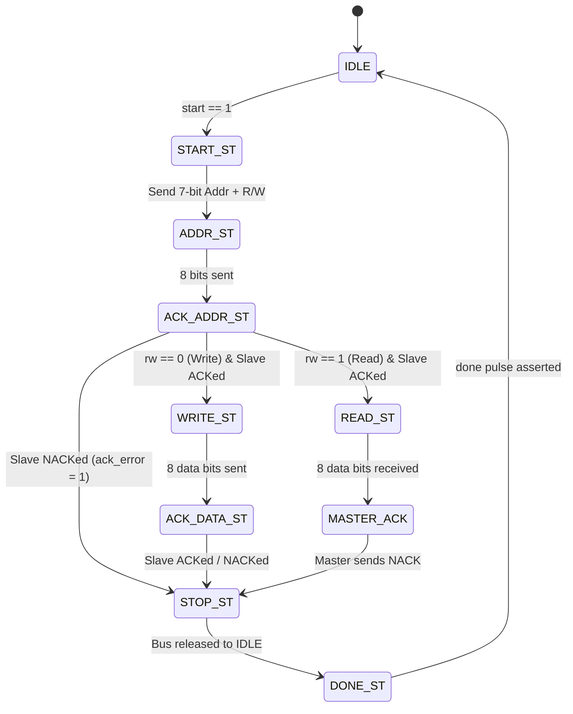

# I2C Master Controller

A synthesizable, robust, and industry-standard **I2C Master Controller** implemented in SystemVerilog.

This design supports standard 7-bit addressing, single-byte Write and Read transactions, dynamic ACK/NACK detection, glitch-free START/STOP generation, and standard open-drain bidirectional bus interfacing.

---

## 🌟 Key Features

- **Standard I2C Protocol Compliance**:
  - In-band **START** and **STOP** condition generation.
  - 7-bit device addressing + R/W bit steering.
  - 8-bit bidirectional data transfers (MSB first).
  - Dynamic **ACK / NACK** detection with host error reporting (`ack_error`).
- **4-Phase Quarter-SCL Clocking**:
  - Eliminates race conditions and simplifies setup ($t_{\text{SU}}$) and hold ($t_{\text{HD}}$) timing.
- **Physical Open-Drain Interfacing**:
  - Employs active-low drive with High-Z release (`1'bz`) to prevent short circuits and support multi-device bus contention rules.
- **Fully Parameterized**:
  - Easily adjust `CLK_FREQ` (system clock) and `I2C_FREQ` (e.g. 100 kHz Standard Mode, 400 kHz Fast Mode, or 1 MHz Fast Mode Plus).
- **Self-Checking Verification**:
  - Complete testbench with an interactive behavioral I2C Slave responder (EEPROM-like) verifying Write, Read, and NACK scenarios.

---

## 📐 Architecture & 4-Phase SCL Model

Unlike SPI (which uses simple edge sampling), I2C requires `sda` to transition only when `scl` is **LOW**, and remain stable when `scl` is **HIGH**. Exceptions are START and STOP conditions, which require SDA transitions while SCL is HIGH.

To satisfy all I2C timing rules deterministically, each SCL clock period is divided into **4 discrete quarter-phases**:

```text
Quarter Phase: |   Phase 0   |   Phase 1   |   Phase 2   |   Phase 3   |
SCL Line:      |     LOW     |    HIGH     |    HIGH     |     LOW     |
SDA Action:    |  Setup SDA  |    Rise     | Sample Data |  Fall/Hold  |
               | (Bit change)|             |/START / STOP| (Bit finish)|
```

- **Phase 0 (Setup)**: Master safely drives/changes the SDA bit while SCL is LOW.
- **Phase 1 (Rise)**: SCL line transitions from LOW to HIGH.
- **Phase 2 (Sample / Control Action)**: SCL is stable HIGH:
  - During standard bits: Master or Slave samples the data bit / ACK.
  - During START: SDA transitions HIGH $\rightarrow$ LOW while SCL is HIGH.
  - During STOP: SDA transitions LOW $\rightarrow$ HIGH while SCL is HIGH.
- **Phase 3 (Fall / Hold)**: SCL transitions back to LOW, completing the bit cell.

---

## 🔄 Finite State Machine (FSM)



---

## 📁 Folder Structure

```text
I2C_Master_Controller/
├── src/
│   └── i2c_master.sv       # Synthesizable I2C Master RTL module
├── tb/
│   └── tb_i2c_master.sv    # Self-checking testbench with behavioral Slave model
├── wave/
│   └── i2c_master.vcd      # Simulation waveform output
└── README.md
```

---

## 🔌 Signal Interface

| Signal | Direction | Width | Description |
| :--- | :---: | :---: | :--- |
| `clk` | Input | 1 | System clock (e.g. 50 MHz) |
| `rst_n` | Input | 1 | Asynchronous active-low reset |
| `start` | Input | 1 | Pulse HIGH for 1 cycle to initiate transaction |
| `rw` | Input | 1 | Transfer direction (`0` = Write, `1` = Read) |
| `addr` | Input | 7 | 7-bit target slave address |
| `tx_data` | Input | 8 | Data byte to write to slave |
| `rx_data` | Output | 8 | Data byte read from slave |
| `busy` | Output | 1 | Asserted while transaction is ongoing |
| `done` | Output | 1 | 1-cycle completion pulse |
| `ack_error` | Output | 1 | Asserted if target slave fails to acknowledge (NACK) |
| `scl` | Inout | 1 | I2C Serial Clock (open-drain) |
| `sda` | Inout | 1 | I2C Serial Data (open-drain) |

---

## 🚀 How to Simulate

Compile and run using any standard SystemVerilog simulator (e.g., Icarus Verilog):

```powershell
# 1. Compile the RTL and Testbench
iverilog -g2012 -o tb_i2c_master.vvp "src/i2c_master.sv" "tb/tb_i2c_master.sv"

# 2. Run the simulation
vvp tb_i2c_master.vvp

# 3. View waveforms (optional)
gtkwave "wave/i2c_master.vcd"
```

### Verification Scenarios Tested
1. **Master Write**: Writes byte `0x3C` to Slave `0x50` $\rightarrow$ verifies address ACK, data ACK, and memory update.
2. **Master Read**: Reads byte back from Slave `0x50` $\rightarrow$ verifies received data matches `0x3C`, Master NACK generation, and clean STOP.
3. **NACK Handling**: Attempts transaction with non-existent Slave `0x2A` $\rightarrow$ verifies `ack_error = 1`, immediate transaction abort, and bus recovery.
