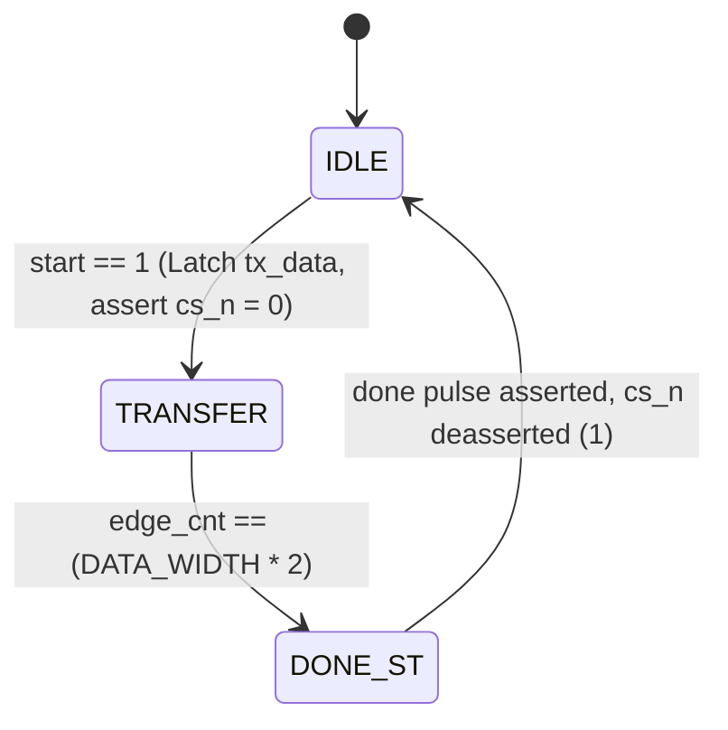

# SPI Master Controller

A parameterizable, synthesizable, and robust **SPI (Serial Peripheral Interface) Master Controller** implemented in SystemVerilog.

This design supports all **4 standard SPI Modes** (configurable via runtime `cpol` and `cpha`), full-duplex simultaneous transmit and receive, programmable clock division, and embedded SystemVerilog Assertions (SVA) for formal protocol safety checking.

---

## 🌟 Key Features

- **Full 4-Mode SPI Compatibility**:
  - **Mode 0** (`cpol = 0, cpha = 0`): SCLK idle LOW; sample on leading (rising) edge, shift on trailing (falling) edge.
  - **Mode 1** (`cpol = 0, cpha = 1`): SCLK idle LOW; shift on leading (rising) edge, sample on trailing (falling) edge.
  - **Mode 2** (`cpol = 1, cpha = 0`): SCLK idle HIGH; sample on leading (falling) edge, shift on trailing (rising) edge.
  - **Mode 3** (`cpol = 1, cpha = 1`): SCLK idle HIGH; shift on leading (falling) edge, sample on trailing (rising) edge.
- **Parameterized & Configurable**:
  - `DATA_WIDTH`: Word size parameter (default: 8 bits).
  - `clk_div[7:0]`: Dynamic runtime clock divider for generating serial clock (`sclk`) from system clock (`clk`).
- **Hardware Protocol Integrity (SVA)**:
  - Embedded SystemVerilog Assertions verify that `busy` and `done` are mutually exclusive.
  - SVA verifies `cs_n` is strictly active (LOW) whenever `sclk` toggles.
- **Full-Duplex Data Path**:
  - Simultaneous MSB-first transmission (`mosi`) and reception (`miso`).

---

## 📐 SPI Mode Matrix

| Mode | `cpol` | `cpha` | SCLK Idle State | Data Sample Edge | Data Shift Edge |
| :---: | :---: | :---: | :---: | :---: | :---: |
| **0** | `0` | `0` | LOW (`0`) | Rising (Leading) | Falling (Trailing) |
| **1** | `0` | `1` | LOW (`0`) | Falling (Trailing) | Rising (Leading) |
| **2** | `1` | `0` | HIGH (`1`) | Falling (Leading) | Rising (Trailing) |
| **3** | `1` | `1` | HIGH (`1`) | Rising (Trailing) | Falling (Leading) |

---

## 🔄 Finite State Machine (FSM)



- **IDLE**: Controller waits for `start`. `cs_n` is HIGH (`1`), `sclk` rests at `cpol`.
- **TRANSFER**: `cs_n` pulls LOW (`0`). `baud_cnt` runs at $2\times$ oversampling to generate discrete clock edges. `edge_cnt` counts $2 \times \text{DATA\_WIDTH}$ half-cycles (16 edges for 8 bits).
- **DONE_ST**: Single-cycle pulse asserts on `done`, signaling the host that `rx_data` is valid.

---

## 📁 Folder Structure

```text
SPI_Master_Controller/
├── src/
│   └── spi_master.sv       # Synthesizable SPI Master controller
├── tb/
│   └── tb_spi_master.sv    # Self-checking testbench
├── wave/
│   └── spi_master.vcd      # Simulation waveform output
└── README.md
```

---

## 🔌 Signal Interface

| Signal | Direction | Width | Description |
| :--- | :---: | :---: | :--- |
| `clk` | Input | 1 | System clock |
| `rst_n` | Input | 1 | Active-low asynchronous reset |
| `start` | Input | 1 | Pulse HIGH for 1 cycle to launch transfer |
| `cpol` | Input | 1 | Clock Polarity (`0` = Idle Low, `1` = Idle High) |
| `cpha` | Input | 1 | Clock Phase (`0` = Sample Leading, `1` = Sample Trailing) |
| `clk_div` | Input | 8 | Division factor for SCLK rate generation |
| `tx_data` | Input | `DATA_WIDTH` | Data word to transmit |
| `rx_data` | Output | `DATA_WIDTH` | Data word received simultaneously from slave |
| `busy` | Output | 1 | High during active transaction |
| `done` | Output | 1 | 1-cycle pulse upon completion |
| `sclk` | Output | 1 | SPI Serial Clock output |
| `mosi` | Output | 1 | Master Out Slave In serial data |
| `miso` | Input | 1 | Master In Slave Out serial data |
| `cs_n` | Output | 1 | Active-low Slave Chip Select |

---

## 🚀 How to Simulate

```powershell
# 1. Compile with Icarus Verilog
iverilog -g2012 -o tb_spi_master.vvp "src/spi_master.sv" "tb/tb_spi_master.sv"

# 2. Run simulation
vvp tb_spi_master.vvp

# 3. View waveforms (optional)
gtkwave "wave/spi_master.vcd"
```
